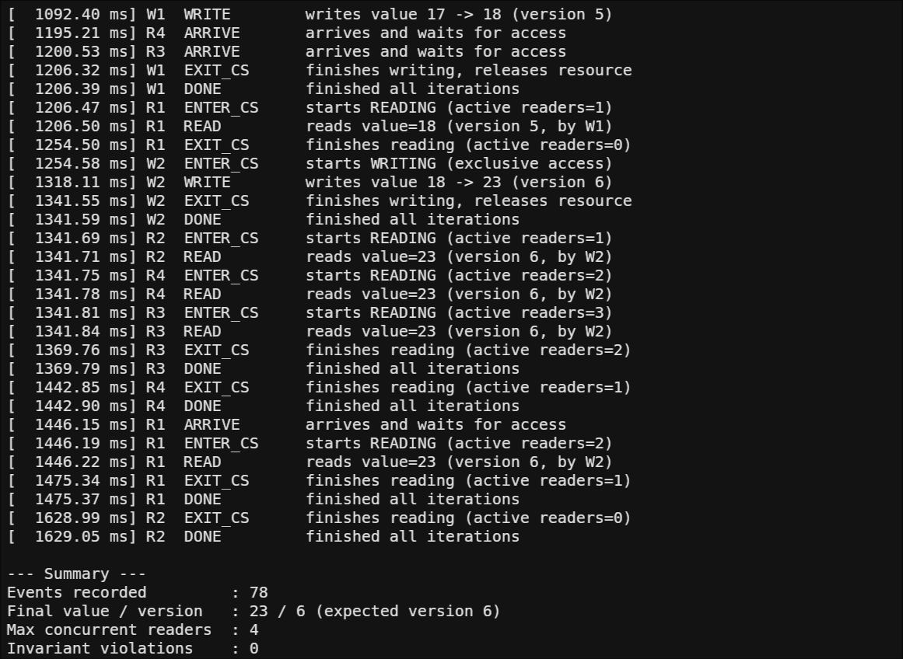
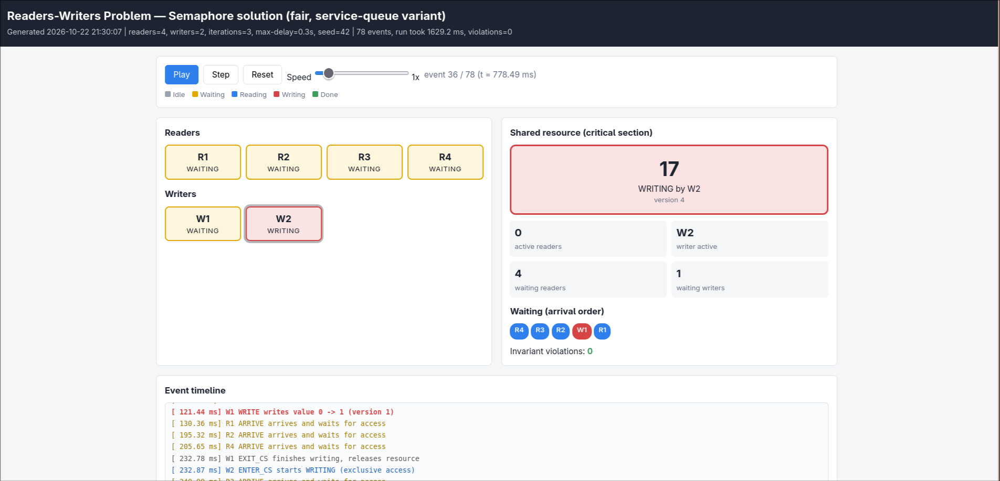
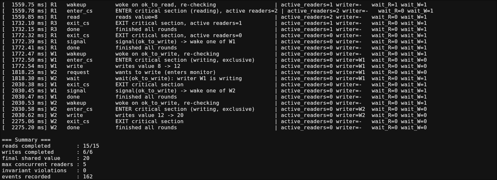
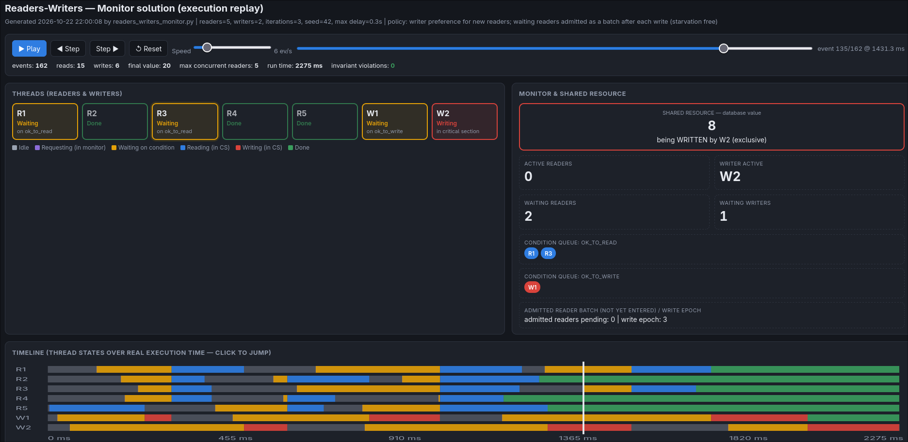
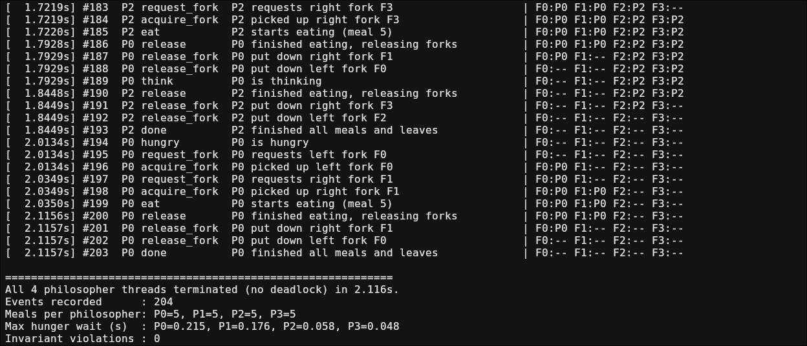
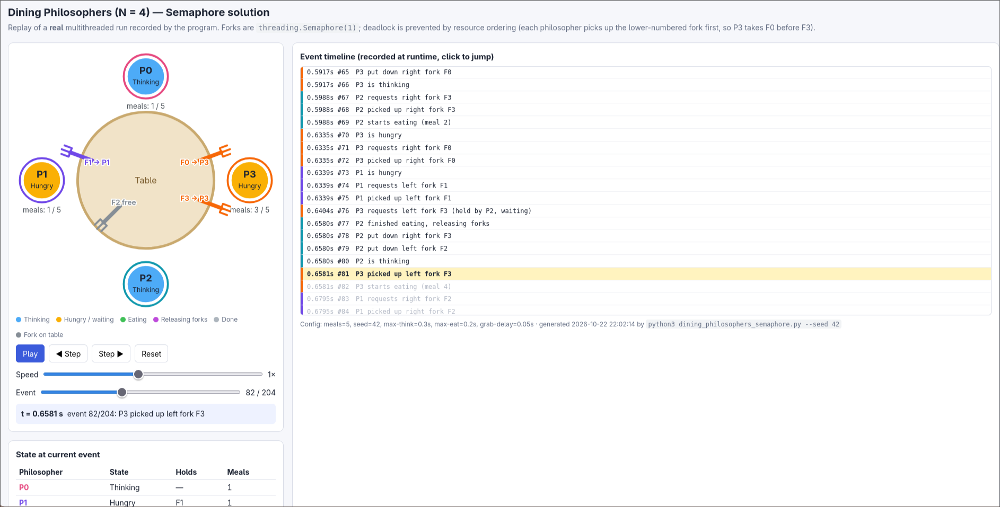
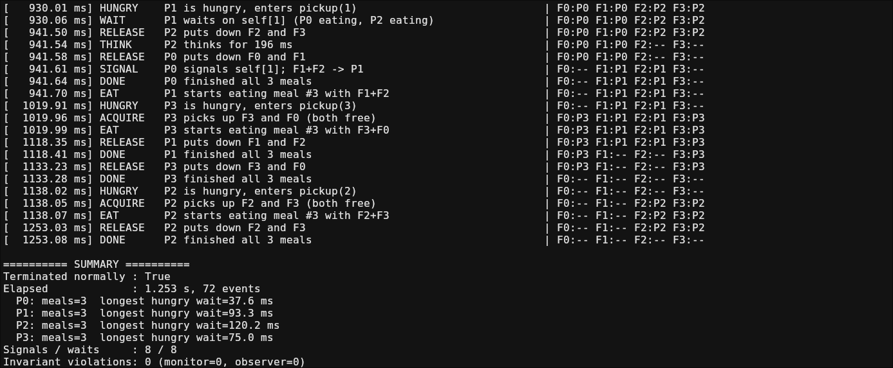
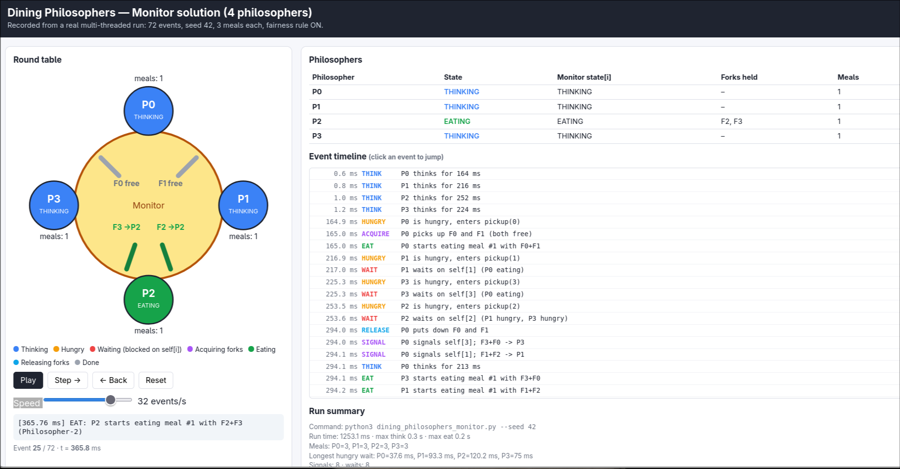

# OS Assignment 2: Synchronization Algorithms with Program-Generated HTML Simulation

| | |
|---|---|
| **Student** | Felicia Fernandes |
| **USN** | NNM24IS083 |
| **Course** | Operating Systems |
| **Language** | Python 3 (tested on Python 3.14), standard library only |
| **Repository** | https://github.com/feliciafernandes/os-task-2 |

This repository has my solutions to four classic synchronization problems. Every program runs real threads, and when it finishes it writes an HTML page that replays the run it just did:

```
Execute program -> threads synchronize -> EventRecorder captures every state change
               -> events embedded as JSON in an HTML file -> replay in the browser
```

## Implementations

| # | Problem | Synchronization | Source | Generated HTML |
|---|---|---|---|---|
| 1 | Readers-Writers | Semaphores (`threading.Semaphore`): fair "service queue" variant, so neither readers nor writers starve | [readers_writers/semaphore/](readers_writers/semaphore/) | [readers_writers_semaphore.html](generated_html/readers_writers_semaphore.html) |
| 2 | Readers-Writers | Monitor (`ReadWriteMonitor`: one `Lock` and two `Condition`s, `ok_to_read`/`ok_to_write`): new readers wait behind waiting writers, and waiting readers are let in as a batch after each write | [readers_writers/monitor/](readers_writers/monitor/) | [readers_writers_monitor.html](generated_html/readers_writers_monitor.html) |
| 3 | Dining Philosophers (4) | Semaphores: one binary semaphore per fork. Deadlock is prevented by resource ordering: every philosopher takes the lower-numbered fork first, so P3 takes F0 before F3 | [dining_philosophers/semaphore/](dining_philosophers/semaphore/) | [dining_philosophers_semaphore.html](generated_html/dining_philosophers_semaphore.html) |
| 4 | Dining Philosophers (4) | Monitor (`DiningMonitor`, the Silberschatz `pickup`/`putdown`/`test` solution): one `Lock`, one `Condition` per philosopher, and an optional ticket rule against starvation (`--fair`) | [dining_philosophers/monitor/](dining_philosophers/monitor/) | [dining_philosophers_monitor.html](generated_html/dining_philosophers_monitor.html) |

Each problem folder has its own `README.md` with a detailed explanation. It covers:
- semaphores or monitor design and their initial values
- shared resource and critical section
- deadlock and starvation
- all command-line options

## Requirements

- Python 3.8 or newer. Nothing needs to be installed, because the programs import only `threading`, `argparse`, `json`, `random`, `time` and `pathlib` from the standard library.
- Any modern web browser to view the HTML. The HTML files are self-contained (inline CSS, JS and data) and work offline.

## Build / compile

Python is interpreted, so there is no build step.

## Run and generate the HTML

Each program writes its HTML into `generated_html/` by default. Run from the problem's folder:

```bash
cd "readers_writers/semaphore" && python3 readers_writers_semaphore.py --seed 42
```

```bash
cd "readers_writers/monitor" && python3 readers_writers_monitor.py --seed 42
```

```bash
cd "dining_philosophers/semaphore" && python3 dining_philosophers_semaphore.py --seed 42
```

```bash
cd "dining_philosophers/monitor" && python3 dining_philosophers_monitor.py --seed 42
```

Useful options for the viva, where you may be asked to change the counts or delays and rerun:

| Program | Options |
|---|---|
| Readers-Writers (both) | `--readers N --writers N --iterations N --max-delay SEC --seed N --output PATH --quiet` |
| Dining Philosophers semaphore | `--meals N --max-think SEC --max-eat SEC --grab-delay SEC --timeout SEC --seed N --output PATH --quiet` |
| Dining Philosophers monitor | `--meals N --max-think SEC --max-eat SEC --fair/--no-fair --seed N --output PATH --quiet` |

Example:

```bash
cd "readers_writers/semaphore" && python3 readers_writers_semaphore.py --readers 6 --writers 3 --max-delay 0.5
```

## Viewing the simulation

Open the file in `generated_html/` in a browser (double-click it, or run `xdg-open generated_html/<name>.html`). Every page has Play/Pause, Step, Reset and a speed slider, and every step on the page is an event recorded during the real run.

## Expected output

Each program does three things:
- prints every event (timestamp, thread, state change and the state of the shared resource or forks)
- prints a summary, for example meals per philosopher or the maximum number of concurrent readers
- prints **`Invariant violations: 0`** and the path of the HTML file

The exit code is 0 on success. Screenshots of the console output are in [screenshots/](screenshots/).

### Screenshots

| Problem | Console | HTML simulation |
|---|---|---|
| RW semaphore |  |  |
| RW monitor |  |  |
| DP semaphore |  |  |
| DP monitor |  |  |

## Correctness checks

- Every program checks its safety invariants while running:
  - Readers-Writers: no writer is ever inside together with a reader or another writer, and no reader sees a half-finished write.
  - Dining Philosophers: no two neighbours eat at the same time, and each fork has at most one owner.
- Each program reports the violation count. It was 0 for every seed tested.
- **Negative tests** showed the checkers really catch errors. With the synchronization removed, the checkers reported 20 violations (RW semaphore), 37 (RW monitor) and 380 (DP monitor, with a deliberately broken `test()`).

## Known limitations

- `--seed` fixes the random delays, but the OS scheduler decides the exact order the threads run in, so two runs with the same seed can differ slightly. The HTML always replays the run that generated it.
- CPython's GIL stops threads from running Python bytecode at the same instant. They are still real OS threads that get pre-empted and that block and wake on the semaphores, locks and conditions, so the synchronization is genuine.
- `threading.Semaphore` and `Condition.notify()` do not guarantee FIFO wake-up. The per-problem READMEs explain what this means for starvation.

## AI tools and references

- AI usage and prompt log: [ai_prompts/prompts.md](ai_prompts/prompts.md)
- References: [references/references.md](references/references.md)
- Report: [report/Assignment_Report.pdf](report/Assignment_Report.pdf)
